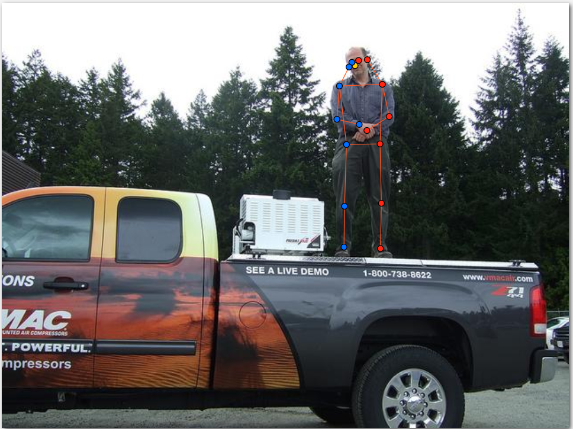
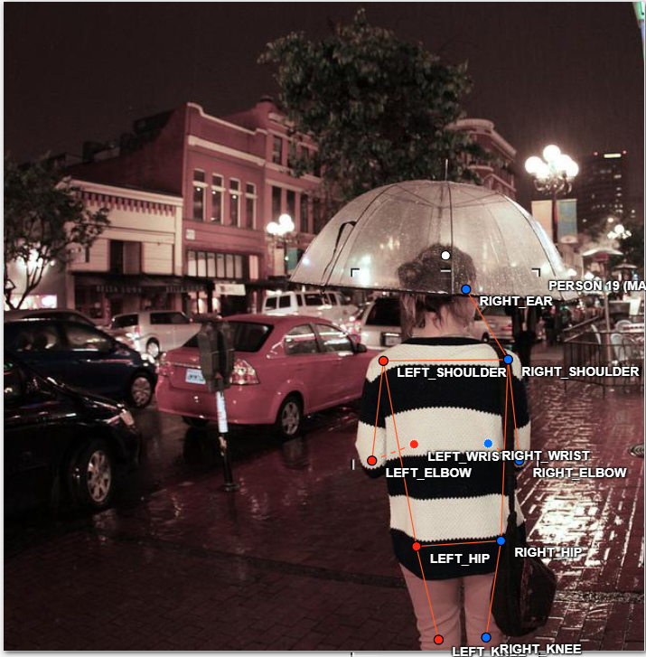
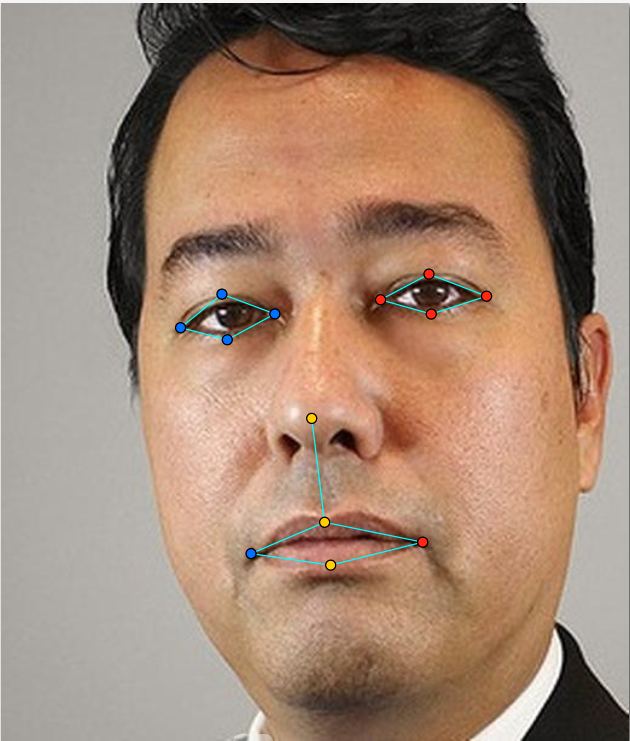
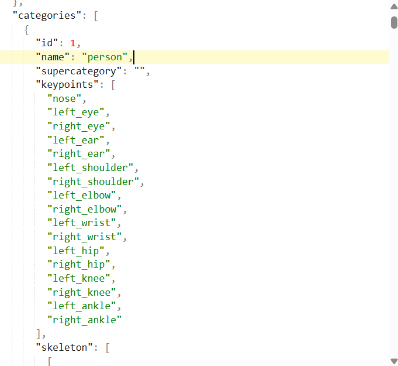

# Báo cáo cá nhân — NguyenBaoKhanh-2A202603191

Dữ liệu: 12 ảnh người COCO val2017 (Lin et al., 2014) và 8 ảnh chân dung Wikimedia Commons, chỉ dùng trong lớp.

## 0. Thông tin học viên

- Họ tên: Nguyễn Bảo Khánh
- MSSV: 2A202603191
- Email: 26ai.khanhnb2@vinuni.edu.vn
- Link repository: https://github.com/NBK1612/K5-L2A-Day04-NguyenBaoKhanh-2A202603191-KeypointPose-Student
- Phiên bản CVAT (Help → About): 2.74.1
- Máy: hệ điều hành Windows 11 Home · RAM 16 GB · chạy CVAT chế độ đầy đủ
- Bộ ảnh (`src/exports/assignment.json` do `lab.py setup` tạo): có
- Giờ bắt đầu: 17:00 12/11/2026
- Giờ kết thúc: 19:00 12/11/2026

## 1. Kiểm tra label (CP0)

| Label    | Kiểu     | Số điểm | Tên điểm đúng bảng của lab? | Đúng thứ tự? | Số cạnh |
| -------- | -------- | ------: | --------------------------- | ------------ | ------: |
| `person` | Skeleton |      17 | Có                          | Có           |      19 |
| `face`   | Skeleton |      13 | Có                          | Có           |      13 |

Mẫu `person` dựng theo người quay mặt về camera (các điểm `left_*` nằm bên phải khung mẫu)? Có

Cách đổi cờ `occluded` / `outside` cho **một điểm** trên phiên bản CVAT này (một câu):

Rê chuột vào đúng điểm đó rồi bấm `Q` (bật/tắt `occluded`, xuất ra `v = 1`) hoặc `O` (bật/tắt `outside`, xuất ra `v = 0`), hoặc chuột phải vào điểm để mở menu có nút outside / khóa / occluded / hidden. Không dùng `hidden` vì nó chỉ ẩn trên màn hình, khi xuất vẫn ra `v = 2`.

## 2. Số lượng đã gán và thời gian (CP1, CP2)

| Nhóm ảnh   | Số ảnh | Số skeleton đã gán | Số người dưới 60 px (không gán) | Số poster / gương / màn hình bỏ qua | Thời gian (phút) |
| ---------- | -----: | -----------------: | ------------------------------: | ----------------------------------: | ---------------: |
| `easy`     |      5 |                  5 |                                 |                                     |                2 |
| `occluded` |      3 |                  6 |                                 |                                     |                2 |
| `back`     |      2 |                  3 |                                 |                                     |                2 |
| `small`    |      1 |                  0 |                                 |                                     |                2 |
| `crowd`    |      1 |                  3 |                                 |                                     |                2 |
| `faces`    |      8 |                  8 |                               — |                                     |                2 |

- Số ảnh người đã xong ở mốc phút 105: 2 / 10
- Thời gian thực tế (phút): CP1 2 · CP2 2 · CP3 2
- Ảnh tốn thời gian nhất là ảnh nào, vì sao?

Ảnh tốn thời gian nhất là ảnh 000000542160.jpg vì có 3 người quay lưng, 1 người nghiêng, 1 người bị che khuất, và có nhiều điểm bị kéo ra mép ảnh nên phải cân nhắc kỹ khi gán.

## 3. Bảng ca khó (CP1, CP2)

Mỗi điểm bạn phân vân một dòng, nhất là phân vân giữa `v = 1` và `v = 0`, hoặc không chắc hướng người.

| Ảnh | Người / mặt | Điểm | Cờ đã chọn | Phân vân giữa | Lý do chọn |
| --- | ----------- | ---- | ---------: | ------------- | ---------- |
|     |             |      |            |               |            |
|     |             |      |            |               |            |
|     |             |      |            |               |            |

## 4. Bảng tự review (CP3)

Đi từ ảnh cuối về ảnh đầu. 5 ảnh người (ít nhất 2 ảnh `back` hoặc `crowd`) và 3 ảnh mặt. Ít nhất 8 dòng, kể cả dòng `ok`. Ghi lỗi trước, sửa sau.

Mã lỗi dùng đúng một trong: `lr_swap`, `vis_flag`, `position`, `missing`, `extra`, `ok`.

| Ảnh                           | Người / mặt | Điểm         | Mã lỗi    | Ghi chú                                                                                   | Đã sửa?                |
| ----------------------------- | ----------- | ------------ | --------- | ----------------------------------------------------------------------------------------- | ---------------------- |
| `000000542160.jpg` (crowd)    | người #1    | gối, cổ chân | `lr_swap` | Cặp gối, cổ chân nằm ngược phía so với vai, hông. Đổi trái/phải một cặp.                  | Đúng rồi không cần sửa |
| `000000521817.jpg` (occluded) | người #2    | cổ chân      | `lr_swap` | Cặp cổ chân nằm ngược phía so với các cặp còn lại. Đổi trái/phải một cặp.                 | Đúng rồi không cần sửa |
| `000000521817.jpg` (occluded) | người #1    | mắt          | `lr_swap` | Cặp mắt nằm ngược phía so với các cặp còn lại. Đổi trái/phải một cặp.                     | Đúng rồi không cần sửa |
| `000000508269.jpg` (easy)     | người #1    | gối, cổ chân | `lr_swap` | Cặp gối, cổ chân nằm ngược phía so với vai, hông. Đổi trái/phải một cặp.                  | Đúng rồi không cần sửa |
| `000000323705.jpg` (small)    | cả ảnh      | —            | `missing` | Ảnh không có skeleton `person` nào; script báo ảnh nào cũng có ít nhất một người cần gán. | Đúng rồi không cần sửa |
| `000000056651.jpg` (occluded) | người #2    | cổ tay       | `lr_swap` | Cặp cổ tay nằm ngược phía so với các cặp còn lại. Đổi trái/phải một cặp.                  | Đúng rồi không cần sửa |

Tổng hợp số lỗi theo mã:

| `lr_swap` | `vis_flag` | `position` | `missing` | `extra` | `ok` |
| --------: | ---------: | ---------: | --------: | ------: | ---: |
|         5 |          0 |          0 |         1 |       0 |      |

Điểm còn phân vân giữa `v = 1` và `v = 0` (ghi cả hai lựa chọn và lý do chọn):

...

## 5. Kiểm file xuất và kết quả tự kiểm (CP4)

Tự kiểm tay trong file JSON (`annotations/person_keypoints_default.json` trong zip):

| File                         | Người / mặt kiểm (ảnh, thứ tự)          | Số phần tử `keypoints` | Điểm `outside` ra `v = 0`, `occluded` ra `v = 1`?               | `num_keypoints` khớp?             |
| ---------------------------- | --------------------------------------- | ---------------------: | --------------------------------------------------------------- | --------------------------------- |
| `NguyenBaoKhanh_persons.zip` | `000000043719.jpg` (back), người #1     |                     51 | Có: 9 điểm `v = 2`, 2 điểm `v = 1`, 6 điểm `v = 0`              | Có: `num_keypoints = 11` = 9 + 2  |
| `NguyenBaoKhanh_persons.zip` | `000000056651.jpg` (occluded), người #2 |                     51 | Có: 15 điểm `v = 2`, 2 điểm `v = 1`, 0 điểm `v = 0`             | Có: `num_keypoints = 17` = 15 + 2 |
| `NguyenBaoKhanh_faces.zip`   | `face_219250.jpg`, mặt #1               |                     39 | Có: 5 điểm `v = 2`, 8 điểm `v = 1` (8 điểm mắt), 0 điểm `v = 0` | Có: `num_keypoints = 13` = 5 + 8  |

Sau khi xuất, CVAT ghi `occluded` thành `v = 1` và `outside` thành `v = 0`. Tọa độ của điểm `outside` trong file là `0, 0` hay tọa độ cũ? Tọa độ cũ (CVAT 2.x xuất như vậy; chuẩn COCO ghi `0, 0`). Không ảnh hưởng vì điểm `v = 0` bị bỏ qua khi huấn luyện và khi chấm.

Hai job đã chuyển sang completed trên CVAT? Có

Dán phần **TÓM TẮT** in ra từ `src/check_submission.py`:

```text
----- TÓM TẮT (dán vào báo cáo mục 5) -----
- File person: NguyenBaoKhanh_persons.zip
  Số ảnh: 12 · số skeleton `person`: 17 · mỗi annotation 51 số
  Skeleton theo ảnh: 000000043719=1, 000000056651=2, 000000091637=2, 000000150500=1, 000000196283=1, 000000295358=1, 000000323705=0, 000000391222=2, 000000429594=1, 000000508269=1, 000000521817=2, 000000542160=3
  Cờ v: v=2 245 (85%) · v=1 9 (3%) · v=0 35 (12%)
  num_keypoints trung bình: 14.9
- File face: NguyenBaoKhanh_faces.zip
  Số ảnh: 8 · số skeleton `face`: 8 · mỗi annotation 39 số
  Skeleton theo ảnh: face_145621=1, face_168953=1, face_219250=1, face_232598=1, face_264124=1, face_333134=1, face_85624=1, face_92028=1
  Cờ v: v=2 96 (92%) · v=1 8 (8%) · v=0 0 (0%)
  num_keypoints trung bình: 13.0
- Ghi chú: 35 điểm v = 0 vẫn mang tọa độ cũ (CVAT 2.x xuất như vậy; chuẩn COCO ghi 0, 0). Không phải lỗi: điểm v = 0 bị bỏ qua khi huấn luyện và khi chấm.
- Số [LỖI]: 0 · số [CẢNH BÁO]: 6
Kết quả: ĐẠT (đọc lại từng cảnh báo ở trên)
```

Các `[CẢNH BÁO]` còn giữ nguyên và lý do:

| Cảnh báo                                                           | Lý do giữ nguyên / đã sửa |
| ------------------------------------------------------------------ | ------------------------- |
| `000000056651.jpg` #2: cặp wrist ngược phía so với các cặp còn lại | đã đúng                   |
| `000000323705.jpg`: không có skeleton `person` nào                 | đã đúng                   |
| `000000508269.jpg` #1: cặp knee, ankle ngược phía                  | đã đúng                   |
| `000000521817.jpg` #1: cặp eye ngược phía                          | đã đúng                   |
| `000000521817.jpg` #2: cặp ankle ngược phía                        | đã đúng                   |
| `000000542160.jpg` #1: cặp knee, ankle ngược phía                  | đã đúng                   |

## 6. Ảnh chụp màn hình

1. Label `person` trong label constructor (đủ 17 điểm có tên):

   

2. Một người quay lưng đã gán, cờ đã đặt:

   

3. Một khuôn mặt đã gán 13 điểm, phóng to vùng mắt:

   

4. Một đoạn JSON xuất của một người:

   

Nguồn ảnh: COCO val2017 / Wikimedia Commons.

## 7. Tự đánh giá

1. Lỗi bạn mắc nhiều nhất hôm nay, và cách bạn sẽ tránh ở dự án thật:

   ...

2. Một quy tắc bạn đề xuất thêm vào guideline (kèm ảnh ví dụ nếu có):

   ...

3. Nhãn của bạn đi vào model ở đâu? Chọn một lỗi bạn đã sửa và nói nó sẽ làm model học sai thế nào (heatmap, trọng số trong loss, hay bước lật ảnh):

   ...

## 8. Khó khăn và lỗi kỹ thuật

...

## Bonus (nếu làm)

### B1 — 3 ảnh người khó thêm

| Ảnh                | Số skeleton | Số người dưới 60 px | Ca khó nhất |
| ------------------ | ----------: | ------------------: | ----------- |
| `000000161603.jpg` |           0 |                     |             |
| `000000337458.jpg` |           3 |                     |             |
| `000000465765.jpg` |           3 |                     |             |

Kết quả `src/check_submission.py` cho `NguyenBaoKhanh_bonus_persons.zip`:

```text
- File person: NguyenBaoKhanh_bonus_persons.zip
  Số ảnh: 3 · số skeleton `person`: 6 · mỗi annotation 51 số
  Skeleton theo ảnh: 000000161603=0, 000000337458=3, 000000465765=3
  Cờ v: v=2 78 (76%) · v=1 9 (9%) · v=0 15 (15%)
  num_keypoints trung bình: 14.5
- File face: NguyenBaoKhanh_bonus_faces.zip
  Số ảnh: 5 · số skeleton `face`: 5 · mỗi annotation 39 số
  Skeleton theo ảnh: face_280788=1, face_300200=1, face_344941=1, face_379585=1, face_45276=1
  Cờ v: v=2 65 (100%) · v=1 0 (0%) · v=0 0 (0%)
  num_keypoints trung bình: 13.0
- Ghi chú: 15 điểm v = 0 vẫn mang tọa độ cũ (CVAT 2.x xuất như vậy; chuẩn COCO ghi 0, 0). Không phải lỗi: điểm v = 0 bị bỏ qua khi huấn luyện và khi chấm.
- Số [LỖI]: 0 · số [CẢNH BÁO]: 4
Kết quả: ĐẠT (đọc lại từng cảnh báo ở trên)
```

Cảnh báo "File có 3 ảnh, bài giao 12 ảnh" và "File có 5 ảnh, bài giao 8 ảnh" là do script mặc định so với số ảnh của bài chính; bonus B1 có 3 ảnh, B2 có 5 ảnh nên đúng số.

### B2 — 5 ảnh khuôn mặt đen trắng / hồng ngoại

Đã gán đủ 5 mặt (`face_280788`, `face_300200`, `face_344941`, `face_379585`, `face_45276`), mỗi mặt 13 điểm.

Ảnh không màu khó hơn ở điểm nào? Kính râm trên ảnh hồng ngoại có còn là `v = 1` không?

...

### B3 — Model so với nhãn của tôi (không tính điểm)

Không làm.

## 9. Tài liệu tham khảo và công cụ AI đã dùng

Tài liệu:

- Lin et al., 2014. _Microsoft COCO: Common Objects in Context_. Định dạng COCO Keypoints 1.0.
- Tài liệu trong repo: `docs/GUIDELINE.md`, `docs/CVAT_CHEATSHEET.md`, `docs/COCO_KEYPOINTS.md`, `docs/HUONG_DAN_BANG_HINH.md`.
- CVAT documentation (cvat.ai/docs).

Công cụ AI:

- **Claude (Claude Code):** hỏi cách dùng CVAT (đổi cờ `occluded` / `outside` cho một điểm, export COCO Keypoints 1.0); hỏi quy tắc trái/phải với người quay lưng, người nghiêng và vị trí khớp hông; gửi ảnh chụp màn hình các skeleton đã gán để được nhận xét (lỗi đổi trái/phải, điểm kéo về mép ảnh, cờ chưa đặt).
